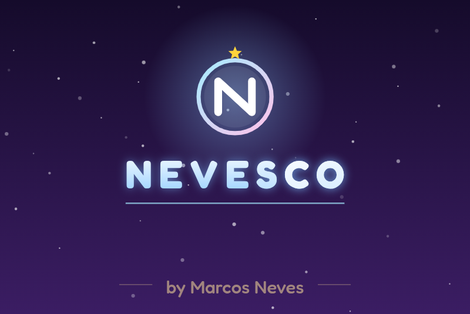
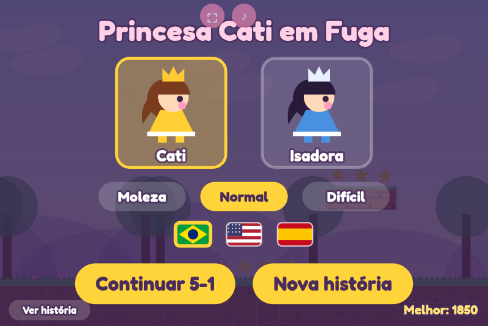
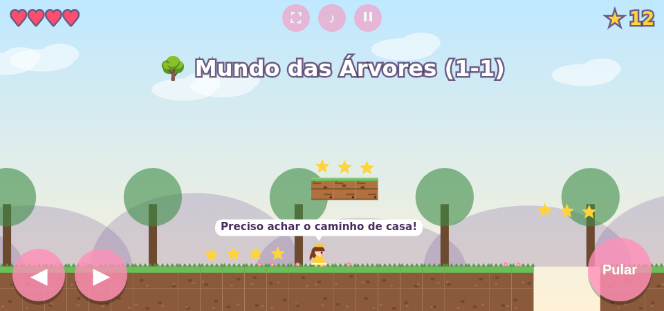
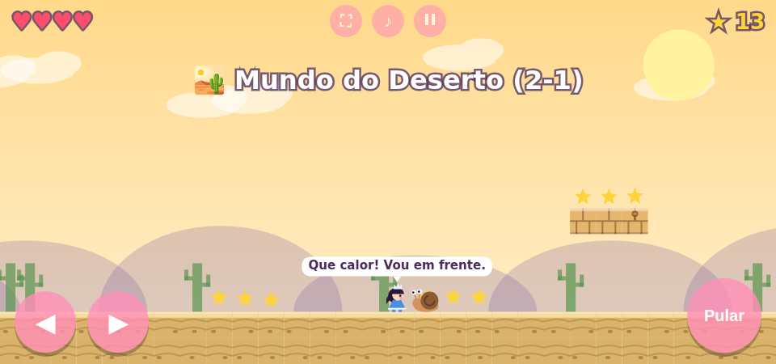
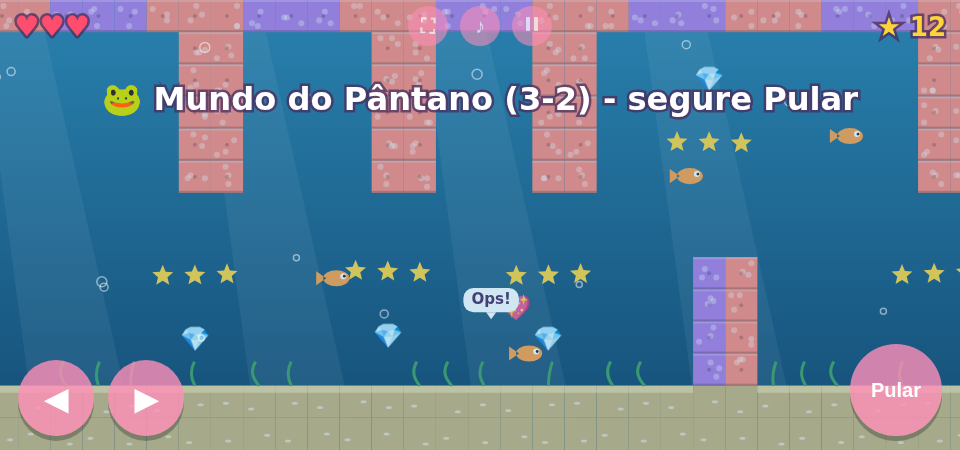
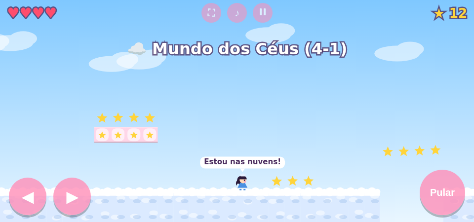
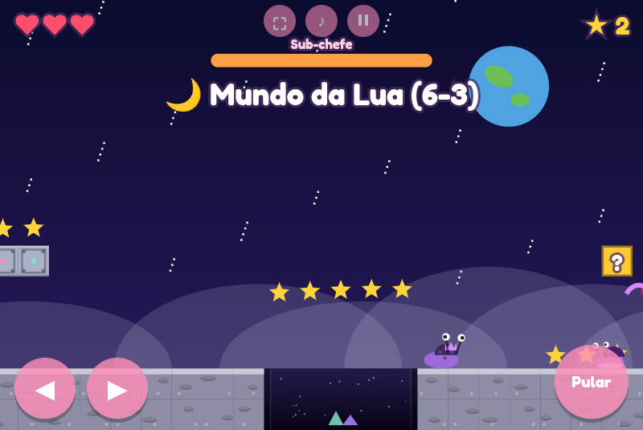
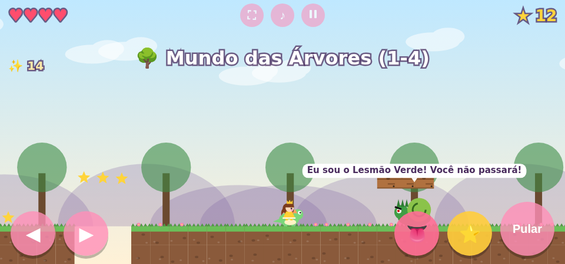
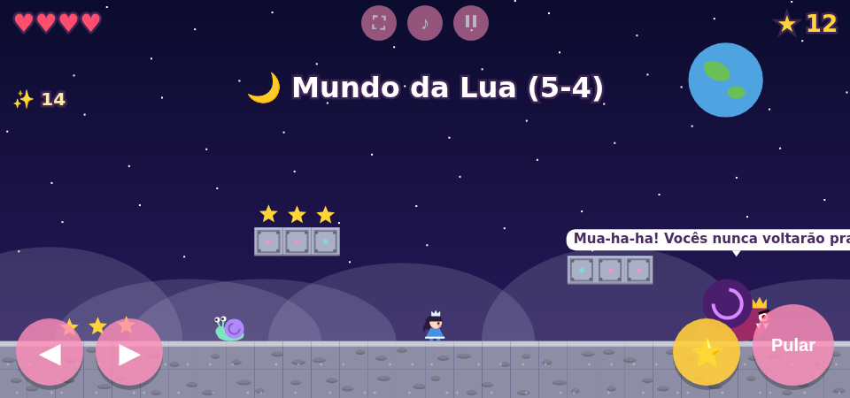

# 👑 Princesa Cati em Fuga

Jogo de plataforma estilo Super Mario Bros, feito em um único arquivo HTML (canvas + JavaScript puro, sem dependências).

▶️ **Jogar online:** `https://nevesm5.github.io/princesa-cati-em-fuga/` 

As irmãs **Cati** e **Isadora** foram sequestradas pelo cruel **Molusco** e levadas para um mundo perigoso. Juntas, elas precisam atravessar 5 mundos para voltar para casa.

## 📸 Prints

| | |
|---|---|
|  |  |
|  |  |
|  |  |
|  |  |
|  | |

## Recursos
- 5 mundos com 4 fases cada: Árvores, Deserto, Pântano (com fases aquáticas), Céus e Lua
- Escolha entre Cati (vestido amarelo) e Isadora (vestido azul)
- Dificuldade: Moleza, Normal e Difícil
- Idiomas: Português, Inglês e Espanhol (escolha salva no aparelho)
- Chefes diferentes em cada mundo, com o Molusco como chefe final
- Blocos "?" com poderes: estrelas mágicas (cada princesa tem a sua) e uma montaria que engole inimigos
- Músicas, efeitos sonoros, pausa e controles de toque para celular

## Controles
| Ação | Teclado | Celular |
|---|---|---|
| Andar | ← → ou A D | botões ◀ ▶ |
| Pular / nadar | ↑, W, Z ou espaço | botão Pular |
| Atirar estrela | X ou K | botão ⭐ |
| Língua do dino | C ou L | botão 👅 |
| Pausa | P ou Esc | botão ⏸ |

## Como jogar
Abra o `index.html` no navegador. Para ir direto a uma fase, adicione `#fase-5` ao endereço (troque o 5 pelo número da fase, de 1 a 20).

---
Uma criação **Nevesco** · by Marcos Neves
